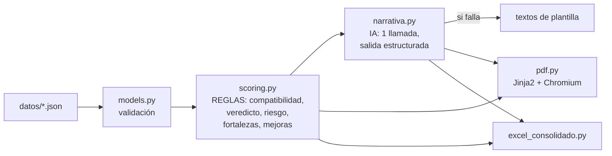

# PrismaHR · Generador de informes de evaluación (v7)

Lee un JSON con empresas y personas evaluadas en 7 competencias y genera:

- **Un PDF de 2 páginas por persona**: compatibilidad con el perfil objetivo, dictamen, radar, fortalezas, riesgo y análisis.
- **Un Excel consolidado por empresa**: ranking, mapa de calor y detalle de dictámenes.
- **Un registro de auditoría por persona** (JSON): qué datos, reglas y fuente de texto produjeron cada informe.

## Cómo funciona



**Principio clave: las reglas deciden, la IA redacta.** El veredicto, el nivel de riesgo, las fortalezas y las áreas de mejora salen de cálculos fijos y explicables (`prismahr/scoring.py`). La IA solo convierte esas conclusiones en texto, y nunca recibe el nombre real de la persona (se usa el marcador `[NOMBRE]`).

### Reglas actuales

| Concepto | Regla |
| :-- | :-- |
| Compatibilidad | `100 − media(|persona − objetivo|)`, escala 0-100 (pesos 0-10 × 10) |
| Veredicto | ≥ 85 Promoción directa · ≥ 72 Formación técnica · ≥ 55 Consolidación · < 55 Plan de mejora |
| Riesgo | Resiliencia < 65 → ALTO · resiliencia < 80 o empatía < 65 → MEDIO · resto → BAJO |
| Fortalezas | Las 3 dimensiones con más puntuación |
| Áreas de mejora | Las 2 dimensiones más por debajo del objetivo |

## Instalación

```bash
python -m venv .venv
```

```bash
source .venv/bin/activate
```

```bash
pip install -e ".[groq]"        # o [anthropic], [openai], [gemini], [todos]
```

```bash
playwright install chromium
```

```bash
cp .env.example .env            # y pon la clave de tu proveedor
```

## Uso

```bash
python -m prismahr
```

Opciones útiles:

```bash
python -m prismahr --datos datos/mi_empresa.json --proveedor anthropic
```

```bash
python -m prismahr --proveedor plantillas    # sin IA y sin coste
```

Los resultados quedan en `salida/pdf`, `salida/excel` y `salida/auditoria`.

## Proveedores de IA

Se elige con `LLM_PROVIDER` (y opcionalmente `LLM_MODEL`) en el `.env`:

| Proveedor | Modelo por defecto | Cómo garantiza el formato |
| :-- | :-- | :-- |
| `groq` | `llama-3.3-70b-versatile` | Modo JSON + validación Pydantic |
| `anthropic` | `claude-opus-5-5` | Salida estructurada nativa |
| `openai` | `gpt-5-mini` | Salida estructurada nativa |
| `gemini` | `gemini-2.5-flash` | JSON con esquema |
| `plantillas` | — | Textos fijos, sin IA |

Si la IA falla (red, cuota, respuesta inválida tras reintentos), esa persona recibe textos de plantilla y el lote continúa. El PDF y el Excel indican siempre qué fuente redactó el texto.

## Formato del JSON de entrada

```json
{
  "empresas": {
    "mi_empresa": {
      "nombre": "Mi Empresa",
      "sector": "Sector",
      "plantilla": { "color_primario": "#1d4ed8", "color_secundario": "#3b82f6", "color_acento": "#f59e0b", "logo_path": "logo.png" },
      "pesos_perfil_objetivo": { "adaptabilidad": 9, "comunicación": 8, "creatividad": 9, "disciplina": 7, "empatía": 7, "iniciativa": 9, "resiliencia": 8 },
      "clientes": [
        {
          "usuario_id": "E-01",
          "nombre": "Nombre Apellido",
          "dimensiones": { "adaptabilidad": 90, "comunicación": 85, "creatividad": 80, "disciplina": 75, "empatía": 70, "iniciativa": 88, "resiliencia": 82 },
          "frases_predeterminadas": ["Observación del evaluador que la IA usará como base."]
        }
      ]
    }
  }
}
```

- Las 7 dimensiones son obligatorias; se aceptan con o sin tilde.
- `logo_path` es opcional y relativo a la carpeta del JSON. Sin logo se muestran las iniciales de la empresa.
- Puntuaciones 0-100; pesos del perfil 0-10.

## Tests

```bash
pip install -e ".[dev]" && pytest
```

## Aviso legal

Usar IA para evaluar a trabajadores se considera **alto riesgo** en el Reglamento Europeo de IA, y el RGPD limita las decisiones automatizadas sobre personas. Este sistema está pensado como **apoyo**: cada informe lo indica y deja un registro de auditoría, pero la decisión final debe tomarla siempre una persona.

Más detalle técnico en [`docs/ADR.md`](docs/ADR.md).
